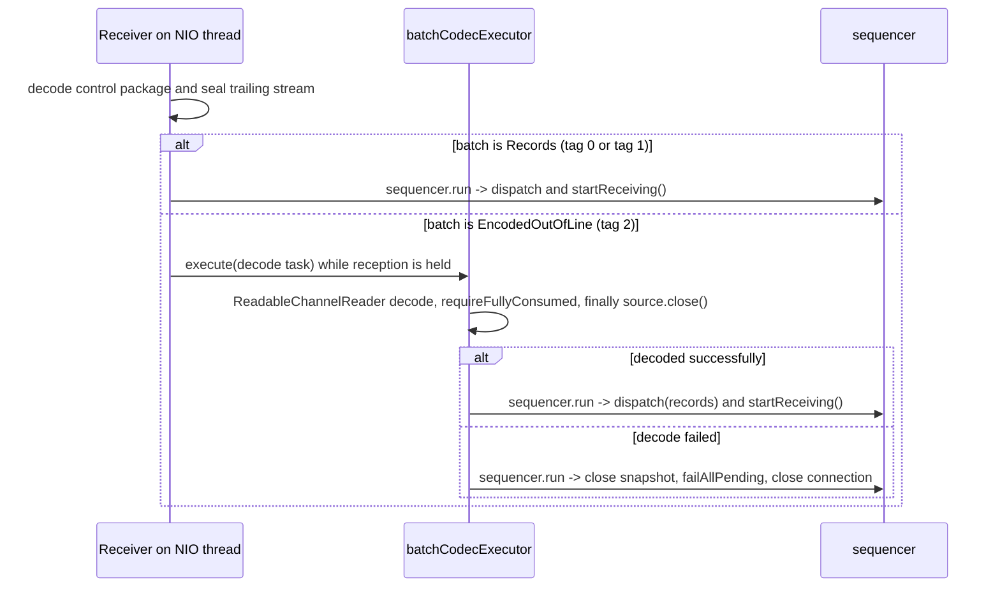

# Architectural Decision Record: Size-Agnostic Consensus Record-Batch Encoding and Negotiated Inline-vs-Stream Placement

**Status:** Accepted

## Context

In the [Lazy Raft Consensus Protocol Specification](lazy-multi-raft-consensus.md), the core consensus state machine (`ConsensusParticipantSdm`) replicates log suffixes to learners by slicing all missing records `[fromIndex, toIndex)` into a single `batch: IArray[Record]` and passing that slice to `ClusterBridge.appendRecords` or `ClusterBridge.installSnapshot`. Keeping `ConsensusParticipantSdm` and `ConsensusClusterBridgeCdm` completely agnostic to byte sizes, frame capacities, and wire serialization formats is a foundational architectural constraint:

1. **Opaque Command Footprint in the Consensus Core:** The consensus core is parametric over an abstract `ClientCommand` type and holds no `Serializer[ClientCommand]`. Consequently, the consensus core cannot know whether a given `IArray[Record]` will encode to 100 bytes or 100 MiB; a batch of 10,000 small commands may fit in a few kilobytes, whereas a batch of a single command carrying a large document or binary blob may exceed several megabytes. Introducing record-count or estimated-byte chunking loops into `ConsensusParticipantSdm` would couple the consensus state machine to transport framing heuristics and degrade replication into multi-round-trip chatty loops without preventing single-record overflow.
2. **Hard Control-Package Capacity Cliff in the Transport Layer:** As specified in [Cluster Binary Serialization & Macro Derivation](cluster-serialization.md) and [Generic Out-of-Line ByteSource Serialization](adr-trailing-stream-bulk-byte-source-transfer.md), `PipelinedTransmitter` encodes each message's control package as a single wire frame into a bounded circular direct-buffer ring of capacity $\text{localTxControlCapacity} = \text{maxRingLengthForTransmission} \times \text{sizeOfBuffersInRing}$, while the peer `Receiver` accumulates that incoming single-frame control package across its circular direct-buffer ring (capped at `buffersInitialLimit = sizeOfBuffersInRing - FRAME_HEADER_MAX_SIZE + 1` per buffer, with space for the single frame header and at least one byte of the terminal sentinel before `buffersInitialLimit`) with guaranteed payload capacity $\text{remoteRxControlCapacity} = \text{maxRingLengthForReception} \times (\text{sizeOfBuffersInRing} - \text{FRAME\_HEADER\_MAX\_SIZE} + 1) - \text{FRAME\_HEADER\_MAX\_SIZE} - 1$. Any control package whose serialized size exceeds either the sender's transmitter ring or the recipient's receiver ring fails immediately with `RingLengthExceededException`. Unless the transport bridge adapts oversized batches into out-of-line `ByteSource` trailing streams, any replication batch exceeding the smaller of those two rings causes a permanent replication liveness stall.
3. **Serialization Ownership Stealing and Sequencer Responsiveness:** `PipelinedTransmitter` is lock-free and thread-safe: when a caller invokes `transmit` while the serialization stage is already occupied, the caller atomically increments the wait-queue counter, enqueues a submission envelope, and returns immediately. Whichever thread subsequently drains that queued submission—either an earlier caller thread still looping in the serialization stage or an NIO.2 socket completion thread finishing a prior transmission—executes `Serializer.serialize` for the queued message. Therefore, simply invoking `PipelinedTransmitter.transmit` from a background worker thread for an unencoded inline batch does not guarantee that heavy serialization runs on that worker thread: if the participant's single-threaded `sequencer` (or a shared NIO.2 completion thread) currently holds serialization ownership on that channel, the heavy batch serialization is stolen onto the `sequencer` or NIO.2 thread, stalling consensus state transitions or cross-connection socket I/O.
4. **Reference Deduplication Coupling Across Composite Messages:** The binary serialization framework (`Serializer.Writer.write` and `Deserializer.Reader.read`) assigns sequential integer keys (`0, 1, 2, ...`) in a per-message deduplication table (`RecyclableIdentityIntMap` / `RecyclableObjectBuffer`). In `InstallSnapshot`, `SnapshotData[ParticipantId]` precedes `batch: IArray[Record]` and populates participant identity references in the enclosing message's deduplication table before `batch` is reached. If a record batch is pre-encoded off-thread using its own standalone `Serializer.Writer` (starting at deduplication index `0`), its back-references are relative to the batch rather than the enclosing message; splicing those raw bytes directly into the enclosing control package and decoding them with the enclosing `Deserializer.Reader` would resolve back-references against the wrong table entries and corrupt deserialization.
5. **Dual-Connection Tie-Breaking Integrity:** When two peers initiate outbound TCP connections to one another simultaneously, tie-breaking closes one socket channel and retains the other. If tie-breaking instantiates multiple connection state containers for the same peer identifier, independent correlation-identifier sequences and pending outbound queues must be merged across instances, creating correlation-identifier collision hazards and dropping queued messages when an accepted channel supersedes an initiated one.

## Options Considered

### 1. Coupling vs. Decoupling Encoding Thread Selection and Wire Placement

- **Option 1A: Four-mode pre-encoding selector (`InlineSync`, `InlineAsync`, `StreamedSync`, `StreamedAsync`) evaluated on `IArray[Record]` before serialization.**
  *Rejected.* First, deciding between inline and streamed placement before serialization is impossible because `IArray[Record]` exposes only record count, not encoded byte size; a single record containing a multi-megabyte `ClientCommand` selected as `InlineSync` or `InlineAsync` will overflow the control package ring and stall replication. Second, `InlineAsync` implemented by calling `PipelinedTransmitter.transmit` from an executor thread violates thread isolation due to `PipelinedTransmitter` serialization ownership stealing. Third, once a batch is pre-encoded into heap buffers, `StreamedSync` offers no advantage over sizing the already-encoded bytes and placing them inline when they fit or out-of-line when they do not.
- **Option 1B: Orthogonal encoding thread strategy (`RecordBatchEncodingStrategy`) paired with exact post-encoding byte-size placement negotiated per connection.**
  *Selected.* The user-configurable selector `IArray[Record] => RecordBatchEncodingStrategy` chooses only *where encoding executes* (`WithinControlPackage`, `StagedOnSequencer`, or `StagedOnCodecExecutor`). Whenever a batch is staged (`StagedOnSequencer` or `StagedOnCodecExecutor`), it is encoded once into a sequence of heap buffers (`EncodedRecordBatch`), yielding its exact encoded byte length. The bridge then compares that exact byte length against the connection's negotiated inline threshold (`maxInlineBatchBytesForPeer`) to place the pre-encoded bytes either inline inside the control package or out-of-line as a trailing `ByteSource` stream.

### 2. Wire Representation and Reference Deduplication Scoping

- **Option 2A: Duplicate wire message classes (`AppendRecords` / `StreamedAppendRecords` and `InstallSnapshot` / `StreamedInstallSnapshot`).**
  *Rejected.* Supporting unstaged inline batches, pre-encoded inline batches (which require an isolated deduplication scope), and pre-encoded out-of-line streamed batches would require six request case classes instead of two, multiplying pattern-match branches across bridge dispatchers and tests to save a single tag byte per RPC.
- **Option 2B: Single `batch: RecordBatch` field with three wire tags and isolated deduplication scopes (`ChunkedHeapWriter`, `NestedScopeReader`, `ReadableChannelReader`).**
  *Selected.* `AppendRecords` and `InstallSnapshot` carry a single `RecordBatch` sum type serialized with a 1-byte VLQ tag:
  - Tag `0` (`Records`): unstaged records serialized and deserialized directly in the enclosing control package's deduplication scope (`WithinControlPackage`), incurring zero intermediate buffer copies.
  - Tag `1` (`EncodedInline`): pre-encoded batch bytes written inline after their unsigned VLQ byte length, decoded on the NIO reception thread through a `NestedScopeReader` that bounds reads to that byte length and uses a fresh `RecyclableObjectBuffer` deduplication table.
  - Tag `2` (`EncodedOutOfLine`): pre-encoded batch bytes wrapped in a `ChunkedBufferByteSource` and emitted via `Writer.putByteSource` into the trailing stream, decoded off-`sequencer` on the bridge codec executor through a `ReadableChannelReader` backed by a fresh `RecyclableObjectBuffer` deduplication table.

### 3. Outbound Thread Coordination and Simultaneous-Connect State Ownership

- **Option 3A: Worker threads invoke `PipelinedTransmitter.transmit` directly; separate `PeerConnection` instances per socket channel merged via `transferPendingTo`.**
  *Rejected.* Calling `transmit` from worker threads races with `sequencer`-driven connection supersession, requires volatile synchronization across otherwise `sequencer`-confined connection fields, and cannot safely re-order or retarget encodings when a connection is replaced. Allocating separate `PeerConnection` instances on outbound and inbound paths splits `lastCorrelationId` and `pendingRequests`, causing correlation-identifier collisions and lost outbound messages during simultaneous-connect tie-breaking.
- **Option 3B: Single canonical `PeerConnection` per peer identifier with a `sequencer`-confined FIFO outbound backlog.**
  *Selected.* The bridge maintains at most one canonical `PeerConnection` per remote `ParticipantId` holding the single `lastCorrelationId` counter, `pendingRequests` map, and `outboundBacklog` queue. Tie-breaking swaps only the attached transport channel handles (`channel`, `receiver`, `transmitter`, `agreedVersion`, `remoteMaxInboundControlPackageBytes`, and `connectionGeneration`). Background encoding tasks on the codec executor post their completed `EncodedRecordBatch` back via `sequencer.run`, and `sequencer` drains ready slots from the head of `outboundBacklog` into `PipelinedTransmitter.transmit` in strict FIFO order.

### 4. Inbound Streamed Batch Decoding and Per-Peer FIFO Ordering

- **Option 4A: Immediately re-arm `Receiver.receive` while decoding streamed batches in parallel, queueing subsequent inbound requests per peer while allowing responses to bypass the queue.**
  *Rejected.* Allowing `Receiver` to continue ingesting new network packages while prior streamed batches are still decoding in background tasks can accumulate an unbounded number of staging files and heap buffers under burst traffic, complicates fault handling if a socket fault occurs while earlier decoded requests are still queued for `sequencer` dispatch, and provides negligible benefit in Lazy Raft because leader-to-follower replication channels carry virtually no responses addressed back to the follower.
- **Option 4B: Pause-and-resume single-flight reception across off-sequencer batch decoding.**
  *Selected.* Because `Receiver` is already single-flight per channel and invokes `onComplete` only after all trailing stream staging sinks are sealed, when a tag `2` (`EncodedOutOfLine`) request arrives, the bridge holds `startReceiving()` while the codec executor decodes the sealed batch `ByteSource` and closes it in a `finally` block. Only after the decoded `IArray[Record]` is dispatched to `ClusterBridge.Delegate` inside `sequencer.run` does the bridge re-arm `startReceiving()`. Per-peer FIFO ordering is preserved by construction with zero queue state, bounded per-connection memory (at most one staged batch and one decoded batch in flight), and natural TCP window backpressure.

## Decision

### Architecture Overview

```mermaid
flowchart LR
  subgraph Leader["Leader (outbound)"]
    Core1["consensus core: appendRecords / installSnapshot"] --> Sel["recordBatchEncodingSelector"]
    Sel -->|"empty -> WithinControlPackage"| BL["canonical PeerConnection outboundBacklog (sequencer)"]
    Sel -->|StagedOnSequencer| EncS["encode on sequencer (ChunkedHeapWriter)"] --> BL
    Sel -->|"non-empty default -> StagedOnCodecExecutor"| EncX["encode on batchCodecExecutor"] -->|"sequencer.run"| BL
    BL -->|"FIFO drain when connected & head ready: place inline (tag 1) or out-of-line (tag 2)"| TX["PipelinedTransmitter"]
  end
  TX -->|"control package + optional trailing stream"| RX
  subgraph Follower["Follower (inbound)"]
    RX["Receiver (NIO thread)"] -->|"Records (tag 0 or tag 1 via NestedScopeReader)"| SeqD["sequencer: dispatch + startReceiving()"]
    RX -->|"EncodedOutOfLine (tag 2), reception paused"| Dec["decode on batchCodecExecutor (ReadableChannelReader), close source"] -->|"sequencer.run"| SeqD
    SeqD --> Core2["Delegate.onAppendRecords / onInstallSnapshot"]
  end
```

### 1. Encoding Strategy Selector and Safe Default Policy (`ClusterBridgeConfig`)

`ClusterBridgeConfig` defines `RecordBatchEncodingStrategy` and exposes `recordBatchEncodingSelector: IArray[Record] => RecordBatchEncodingStrategy`:

- **`WithinControlPackage`:** The batch is left as `RecordBatch.Records(batch)` (wire tag `0`) and serialized directly into `PipelinedTransmitter`'s circular control-package storage in the enclosing message's deduplication scope. Empty batches (`batch.isEmpty`) are unconditionally normalized to `WithinControlPackage` regardless of the selector's return value, eliminating staging allocations for heartbeat-like empty commit updates.
- **`StagedOnSequencer`:** The batch is pre-encoded synchronously on the participant's `sequencer` thread via `ChunkedHeapWriter` into an `EncodedRecordBatch` with an isolated deduplication scope, and then placed inline (tag `1`) or out-of-line (tag `2`) according to its exact encoded byte size.
- **`StagedOnCodecExecutor`:** The batch is pre-encoded asynchronously on the bridge's `batchCodecExecutor` via `ChunkedHeapWriter` into an `EncodedRecordBatch` with an isolated deduplication scope, keeping the `sequencer` thread completely unblocked during heavy serialization, and then placed inline (tag `1`) or out-of-line (tag `2`) on `sequencer` according to its exact encoded byte size.
- **Default Selector Invariant:** Because `ClientCommand` serialized sizes are opaque prior to encoding, `DefaultRecordBatchEncodingSelector` returns `WithinControlPackage` when `batch.isEmpty` and `StagedOnCodecExecutor` for all non-empty batches (`batch.nonEmpty`). This guarantees that neither the participant's `sequencer` nor the transport control-package buffer ring can be overwhelmed by unexpectedly large commands under default configuration.

### 2. Handshake Control-Package Capacity Negotiation and Exact-Size Placement

Whether a pre-encoded batch fits inline inside a control package depends strictly on the sender's local transmitter control capacity and the remote peer's receiver control capacity:
$$\text{localTxControlCapacity} = \text{maxRingLengthForTransmission} \times \text{sizeOfBuffersInRing}$$
$$\text{remoteRxControlCapacity} = \text{remoteMaxRingLengthForReception} \times (\text{remoteSizeOfBuffersInRing} - (\text{FRAME_HEADER_MAX_SIZE} - 1)) - (\text{FRAME_HEADER_MAX_SIZE} + 1)$$

- Both `PeerHandshake` and `HandshakeAck` advertise the sender's `maxInboundControlPackageBytes: Int` (equal to that node's `localReceiverControlCapacity`).
- Upon completing the handshake and attaching to a `PeerConnection`, the maximum inline batch size for a given outbound RPC on that peer is computed from the peer's advertised `remoteMaxInboundControlPackageBytes` and the message's measured non-batch envelope size `envelopeBytes`:
  $$\text{maxInlineBatchBytesForPeer}(\text{envelopeBytes}) = \; \min\big(\text{localInlineTransmitterControlCapacity},\; \text{remoteMaxInboundControlPackageBytes}\big) - \text{envelopeBytes}$$
  where $\text{localInlineTransmitterControlCapacity} = \min(\text{stagedBatchInlineThreshold},\, \text{maxRingLengthForTransmission}) \times \text{sizeOfBuffersInRing}$ bounds how many transmitter circular buffers a staged inline control package may occupy (`stagedBatchInlineThreshold`, along with `maxRingLengthForTransmission`, `maxRingLengthForReception`, and `minRingLengthOnIdle`, uses the `RingLength` opaque positive integer type `>= 1` and defaults to twice the default `minRingLengthOnIdle`, i.e., `4` buffers), and `envelopeBytes` is measured per message on `sequencer` without static headroom heuristics: for `AppendRecords` it is the fixed primitive envelope byte count plus buffer-boundary alignment slack, and for `InstallSnapshot` it is the fixed non-snapshot envelope byte count plus the serialized size of `SnapshotData[ParticipantId]` (measured via a `sequencer`-reused counting `Serializer.Writer` with `putByteSource` overridden to encode only the `Long` size VLQ without opening `SnapshotByteSource` payload channels) plus buffer-boundary alignment slack.
- After `ChunkedHeapWriter` produces an `EncodedRecordBatch` of `byteLength` bytes:
  - If `byteLength <= maxInlineBatchBytesForPeer`, the batch is wrapped as `RecordBatch.EncodedInline(encoded)` (wire tag `1`) and copied into the control package without trailing-stream framing or receiver staging-sink allocation.
  - If `byteLength > maxInlineBatchBytesForPeer`, the batch is wrapped as `RecordBatch.EncodedOutOfLine(encoded.toByteSource)` (wire tag `2`), transmitting only its VLQ length in the control package and streaming its chunks out-of-line via `STREAM_FOLLOWS_SENTINEL`.

### 3. Isolated Deduplication Scope Primitives (`ChunkedHeapWriter`, `NestedScopeReader`, `ReadableChannelReader`)

To decouple pre-encoded record batches from the enclosing control package's reference deduplication table while preserving full reference deduplication *within* the batch (such as repeated `ParticipantId` instances across `ElectorateChange` records):

- **`ChunkedHeapWriter` and `ChunkedBufferByteSource`:** `ChunkedHeapWriter` extends `Serializer.Writer` with a fresh `RecyclableIdentityIntMap` and writes into a growable sequence of heap `ByteBuffer` chunks (default 64 KiB per chunk), enforcing `allocationLimits.maxByteSourceBytes` during encoding and producing an immutable `EncodedRecordBatch` backed by `ChunkedBufferByteSource` with `Long` byte-size accounting (`size: Long` supporting payloads above 2 GiB when configured).Because all back-reference keys inside `EncodedRecordBatch` are self-contained (`0 .. k-1` relative to the start of the batch), an `EncodedRecordBatch` is completely independent of any enclosing message fields and is valid for any follower sharing the same `ProtocolVersion` without requiring per-record deduplication maps.
- **`NestedScopeReader` (Wire Tag `1`):** Wraps an enclosing `Deserializer.Reader` over a fixed `byteLength` slice with a fresh `RecyclableObjectBuffer` and the enclosing `AllocationLimits`, clamping `remainingContentBytes` to `math.min(enclosing.remainingContentBytes, byteLength - bytesConsumed)` and verifying via `requireFullyConsumed()` that the batch deserializer consumed the exact slice.
- **`ReadableChannelReader` (Wire Tag `2`):** Implements `Deserializer.Reader` with a fresh `RecyclableObjectBuffer` and the bridge's `AllocationLimits` over a `ReadableByteChannel` opened from the sealed inbound `ByteSource`, using `Long` byte accounting, clamping `remainingContentBytes` to `math.min(bytesRemaining, Int.MaxValue)`, and verifying via `requireFullyConsumed()` that no trailing unconsumed bytes remain in the stream.

### 4. Configurable Inbound Staging Allocator (`inboundStagingAllocator`)

`ClusterBridgeConfig` exposes `inboundStagingAllocator: ByteSink.Allocator`, defaulting to `ByteSink.DefaultAllocator(inMemoryThreshold = 4 * 1024 * 1024)` (4 MiB), and passes it to every `Receiver` instance. Because batches placed out-of-line (tag `2`) already exceed `maxInlineBatchBytesForPeer` (typically $\ge 240$ KiB under default 1 MiB rings), raising the bridge's default in-memory staging threshold from `ByteSink.DefaultAllocator`'s 64 KiB baseline to 4 MiB keeps medium-to-large streamed batches in heap memory (`BufferByteSink` / `BufferByteSource`) without touching the file system, while automatically spilling multi-megabyte batches and state machine snapshots (`> 4` MiB) to temporary disk files (`FileByteSink` / `FileByteSource`).

### 5. Deterministic Resource Cleanup, Fail-Fast Reporting, and Fault Teardown

- **Fail-Fast Outbound Transmission Reporting:** Every outbound RPC transmission attaches a completion callback to `PipelinedTransmitter.transmit`. If the transmitter reports `NotDelivered` (for example, `RingLengthExceededException` when a user forces `WithinControlPackage` on an oversized batch, or `ByteSourceProblem` / socket failure), the bridge immediately hops to `sequencer` and fails the pending RPC `Captor` rather than leaving it hanging until timeout.
- **Immediate Streamed Batch `ByteSource` Disposal:** On the inbound tag `2` path, the codec executor closes the temporary batch `ByteSource` in a `finally` block immediately after `ReadableChannelReader` finishes or throws, deleting any backing temporary file before `Delegate.onAppendRecords` or `Delegate.onInstallSnapshot` is invoked.
- **`InstallSnapshot` State Machine Snapshot Ownership Guard:** Across all early-exit and failure paths prior to `Delegate.onInstallSnapshot` adopting the snapshot—including inbound batch decode failures, codec executor rejection during shutdown, bridge closure or connection supersession prior to `sequencer` dispatch, unbound delegate (`boundDelegate == null`), synchronous exceptions thrown by `onInstallSnapshot`, and asynchronous failure of the `Capture` returned by `onInstallSnapshot`—the bridge explicitly closes `snapshot.stateMachineSnapshot`.
- **Decode Fault Connection Teardown:** Any deserialization or `AllocationLimits` exception thrown while decoding an out-of-line batch on the codec executor is treated identically to a transport `Receiver.Fault`: the bridge closes the batch and snapshot sources, fails all pending RPCs on that connection, closes the socket channel, and removes the connection from active routing.

## Invariants

- **Consensus Core Size-Agnosticism Invariant:** `ConsensusParticipantSdm` and `ConsensusClusterBridgeCdm` must never inspect serialized byte lengths, frame sizes, or batch record-count caps; all batch encoding, sizing, and streaming adaptation are encapsulated within the transport bridge implementation.
- **Empty Batch Zero-Overhead Invariant:** An empty record batch (`batch.isEmpty`) must always use `WithinControlPackage` (wire tag `0`), bypassing staging buffers, codec executor submission, and trailing stream framing regardless of the configured `recordBatchEncodingSelector`.
- **Negotiated Inline Placement Bound Invariant:** A pre-encoded batch (`EncodedRecordBatch`) may be placed inline (wire tag `1`) only when its exact encoded byte length is less than or equal to $\max\!\big(0,\; \min\big(\text{localInlineTransmitterControlCapacity},\; \text{remoteMaxInboundControlPackageBytes}\big) - \text{envelopeBytes}\big)$ for that message's measured non-batch `envelopeBytes`; otherwise it must be transmitted out-of-line (wire tag `2`).
- **Batch Deduplication Scope Isolation Invariant:** Every pre-encoded record batch (wire tags `1` and `2`) must be serialized with a fresh `RecyclableIdentityIntMap` and deserialized with a fresh `RecyclableObjectBuffer` whose lifetime is strictly bounded to that batch, ensuring zero reference-key interference with enclosing message fields such as `SnapshotData`.
- **Canonical PeerConnection and Sequencer-Confined Outbound Drain Invariant:** At most one `PeerConnection` instance may exist per remote `ParticipantId` in `Nio2ClusterBridge`. All correlation-identifier allocation, outbound backlog ordering, connection generation tracking, and `PipelinedTransmitter.transmit` invocations for RPC requests must execute on the participant's `sequencer` thread in strict FIFO submission order.
- **Single-Flight Pause-and-Resume Inbound Decoding Invariant:** While an inbound `EncodedOutOfLine` batch is being decoded on the codec executor, `Receiver.receive` must remain paused on that peer connection until the decoded batch has been dispatched to `ClusterBridge.Delegate` on `sequencer` (or the connection has been torn down on decode failure), guaranteeing per-peer FIFO RPC delivery without unbounded inbound request queueing.

## Consequences

- **Zero-Overhead Fast Path for Empty Batches and Small Inline Messages:** Empty `AppendRecords` messages (commit-index notifications and probes) and `WithinControlPackage` batches execute with zero extra allocations, zero thread hops, and only 1 byte of tag overhead on the wire.
- **Complete Sequencer Protection and Elimination of Control-Ring Overflows:** Under the default `StagedOnCodecExecutor` strategy for non-empty batches, heavy `ClientCommand` serialization and deserialization never block the `sequencer` thread or NIO.2 socket completion threads, and batches of any size up to `AllocationLimits.maxByteSourceBytes` automatically transition from inline control packages (tag `1`) to constant-memory trailing streams (tag `2`) once they exceed the connection's negotiated inline threshold.
- **Future Broadcast Encoding Reuse Enabled Without Per-Record Maps:** Because `EncodedRecordBatch` uses a batch-scoped deduplication table and immutable heap chunks (`ChunkedBufferByteSource`), a leader replicating identical `(prevLogIndex, batch)` slices to multiple followers running the same `ProtocolVersion` can share a single `EncodedRecordBatch` across followers without re-encoding or maintaining per-record deduplication tables.
