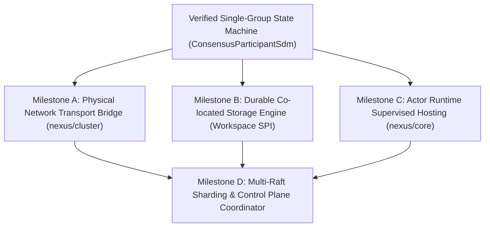

# Matrix System Architecture Roadmap

This bundle establishes the operational roadmap, architectural gap analysis, milestone specifications, and dependency graph for transitioning the Matrix framework from a verified single-group consensus prototype to a production-grade
distributed Multi-Raft application runtime as specified in the [Multi-Raft System Architecture](../architecture/system-architecture.md).

---

## 1. Architectural Alignment Matrix

The following matrix compares each architectural pillar and invariant defined in the [Multi-Raft System Architecture](../architecture/system-architecture.md) against the current implementation in the codebase.

| Architectural Pillar / Subsystem          | Specified Architecture in OKF                                                                                                              | Current Codebase Implementation                                                                                                     | Status                           |
|:------------------------------------------|:-------------------------------------------------------------------------------------------------------------------------------------------|:------------------------------------------------------------------------------------------------------------------------------------|:---------------------------------|
| **Deterministic Sequencing**              | Single-threaded actor execution using causal promises and mutation barriers.                                                               | Implemented via `Doer` and `CausalFence` in `sequencer/core`.                                                                       | **Complete (100%)**              |
| **Reactive Lazy Consensus**               | Heartbeat-less, zero-idle load, on-demand `HowAreYou` discovery, pre-vote ballot election, centralized command applier, follower parity.   | Fully implemented in `ConsensusParticipantSdm`; verified with property tests in `ConsensusParticipantSdmSyncTest`.                  | **Complete (100% Core Logic)**   |
| **Cluster Network Transport**             | Non-blocking NIO2 asynchronous socket channels, sequential frame transmitters, and handshaking.                                            | Transport engine exists in `ParticipantService` (`nexus/cluster`), but consensus RPC bridge is unimplemented.                       | **Partial (25% Transport Only)** |
| **Shared-Nothing Co-located Persistence** | Decoupled Storage SPI (`Workspace`) co-located with compute, handling prefix/suffix truncation, raw WAL appends, and snapshot persistence. | Abstract SPI declared in `ConsensusPrimaryStateCdm.Workspace`; only in-memory mock `ConsensusEnvironment` exists. No disk engine.   | **Partial (20% SPI Only)**       |
| **Supervised Actor Runtime**              | Shard coordinators, workers, and delegates managed as supervised actants structured via Component Definition Modules.                      | Core actor runtime exists in `ActantCore` and `Nexus` (`nexus/core`), but consensus participants are unhosted.                      | **Partial (30% Engine Only)**    |
| **Multi-Raft Sharding**                   | Independent consensus groups per entity/shard providing blast radius isolation and supporting millions of dormant shards in memory.        | Not implemented. Codebase only hosts a single consensus group instance. No shard manager, activation coordinator, or routing layer. | **Unimplemented (0%)**           |
| **Control vs. Data Plane Separation**     | Global Control Raft managing cluster membership and shard topology with total routing replication (Zero-RTT routing).                      | Not implemented. No control plane state machine or shard directory replication.                                                     | **Unimplemented (0%)**           |

---

## 2. Current Architectural Gap Analysis

The consensus engine has achieved mathematical and algorithmic correctness under isolated single-group deterministic simulation. However, three foundational gaps prevent this engine from operating as a production distributed runtime:

1. **Physical Transport Gap**: The `ConsensusParticipantSdm.ClusterParticipant` contract is abstract. The engine cannot transmit consensus RPCs (`HowAreYou`, `RequestBallot`, `AppendRecords`) or client commands over actual TCP/IP networks,
   relying entirely on in-process simulated channels.
2. **Physical Persistence Gap**: The engine delegates durability to `ConsensusPrimaryStateCdm.Workspace`, but no disk-backed implementation exists. Crashes lose all volatile state, log truncation cannot be verified against physical storage
   pages, and snapshot installation does not touch non-volatile media.
3. **Multi-Raft & Lifecycle Orchestration Gap**: The architecture requires hosting thousands to millions of dormant shards that activate on-demand upon client command arrival ("first-stitch" recovery). Currently, there is neither an actor
   lifecycle bridge connecting consensus participants to `nexus/core` nor a Shard Coordinator multiplexing requests across multiple Raft groups.

---

## 3. Implementation Dependency Graph & Execution Paths

The following graph illustrates the structural dependencies between implementation milestones:

### Viable Execution Paths

- **Path 1 (Network-First: M-A &rarr; M-B &rarr; M-C &rarr; M-D)**: Connects `consensus` to `nexus/cluster` first. Enables multi-process distributed testing across physical loopback/network nodes early, proving serialized RPCs over TCP
  before introducing disk I/O.
- **Path 2 (Storage-First: M-B &rarr; M-A &rarr; M-C &rarr; M-D)**: Implements the durable `Workspace` first. Proves physical durability, restart recovery, suffix truncation, and snapshot persistence on disk using the deterministic test
  harness before introducing network non-determinism.
- **Path 3 (Concurrent Foundation: [M-A + M-B] &rarr; M-C &rarr; M-D)**: Develops the network bridge and storage engine concurrently, as they are fully decoupled via explicit SPI boundaries (`ClusterParticipant` and `Workspace`).

---

## 4. Milestone Status Dashboard

| Milestone ID | Title                               | Target Modules               | Status      | Primary Prerequisite                   | Details                                                             |
|:-------------|:------------------------------------|:-----------------------------|:------------|:---------------------------------------|:--------------------------------------------------------------------|
| **M-A**      | Physical Network Transport Bridge   | `nexus/cluster`, `consensus` | `[TODO]`    | Single-Group Consensus Engine (Passed) | [Specification](milestones/milestone-a-network-transport-bridge.md) |
| **M-B**      | Durable Co-located Storage Engine   | `consensus`, `common`        | `[TODO]`    | Single-Group Consensus Engine (Passed) | [Specification](milestones/milestone-b-durable-storage-engine.md)   |
| **M-C**      | Actor Runtime Supervised Hosting    | `nexus/core`, `consensus`    | `[TODO]`    | Single-Group Consensus Engine (Passed) | [Specification](milestones/milestone-c-actor-runtime-hosting.md)    |
| **M-D**      | Multi-Raft Sharding & Control Plane | `consensus`, `nexus/*`       | `[BLOCKED]` | Milestones M-A, M-B, and M-C           | [Specification](milestones/milestone-d-multi-raft-sharding.md)      |

---

## 5. Architectural References

- [Multi-Raft System Architecture](../architecture/system-architecture.md): Scalability analysis, USL framing, control/data plane separation, and lazy consensus pillars.
- [Lazy Raft Consensus Protocol Specification](../architecture/lazy-multi-raft-consensus.md): Formal single-group state machine invariants, message specifications, and election mechanics.
- [CausalFence and Decoupled Mutation Contract](../architecture/adr-causal-fence-state-synchronization.md): Deterministic mutation barrier and ordered notification invariants.
- [Component Definition Module Pattern](../architecture/adr-component-definition-module-pattern.md): Standardized service decomposition architecture.
