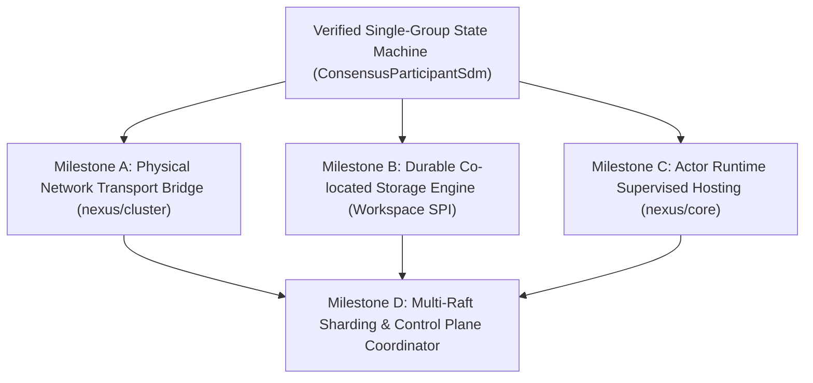

# Matrix System Architecture Roadmap

This bundle establishes the operational roadmap, architectural gap analysis, milestone specifications, and dependency graph for transitioning the Matrix framework from a verified single-group consensus prototype to a production-grade
distributed Multi-Raft application runtime as specified in the [Multi-Raft System Architecture](../architecture/system-architecture.md).

---

## 1. Architectural Alignment Matrix

The following matrix compares each architectural pillar and invariant defined in the [Multi-Raft System Architecture](../architecture/system-architecture.md) against the current implementation in the codebase.

| Architectural Pillar / Subsystem          | Specified Architecture in OKF                                                                                                              | Current Codebase Implementation                                                                                                     | Status                           |
|:------------------------------------------|:-------------------------------------------------------------------------------------------------------------------------------------------|:------------------------------------------------------------------------------------------------------------------------------------|:---------------------------------|
| **Deterministic Sequencing**              | Single-threaded actor execution using causal promises and mutation barriers.                                                               | Implemented via `Doer` and `CausalFence` in `sequencer/core`.                                                                       | **Complete (100%)**              |
| **Reactive Lazy Consensus**               | Heartbeat-less, zero-idle load, on-demand `HowAreYou` discovery, pre-vote ballot election, centralized command applier, follower parity.   | Fully implemented in `ConsensusParticipantSdm`; verified with property tests in `ConsensusParticipantSdmSyncTest`.                  | **Complete (100% Core Logic)**   |
| **Cluster Network Transport**             | Non-blocking NIO2 asynchronous socket channels, sequential frame transmitters, and handshaking.                                            | Production bridge implemented in `Nio2ClusterBridgeCdm` (`consensus/nio2-cluster-bridge`). All consensus and client RPCs, correlation tracking, version negotiation, and trailing stream byte source transfers implemented; all correctness and concurrency defects (Category 1: C1-C9) and documentation/comment integrity (Category 4) verified; performance optimizations (Category 2), code hygiene (Category 3), and predicate-driven `ByteSource` batch streaming for `AppendRecords`/`InstallSnapshot` (Category 6) pending. | **Near Complete / Hardened (90%)** |
| **Shared-Nothing Co-located Persistence** | Decoupled Storage SPI (`Workspace`) co-located with compute, handling prefix/suffix truncation, raw WAL appends, and snapshot persistence. | Abstract SPI declared in `ConsensusPrimaryStateCdm.Workspace`; only in-memory mock `ConsensusEnvironment` exists. No disk engine.   | **Partial (20% SPI Only)**       |
| **Supervised Actor Runtime**              | Shard coordinators, workers, and delegates managed as supervised actants structured via Component Definition Modules.                      | Core actor runtime exists in `ActantCore` and `Nexus` (`nexus/core`), but consensus participants are unhosted.                      | **Partial (30% Engine Only)**    |
| **Multi-Raft Sharding**                   | Independent consensus groups per entity/shard providing blast radius isolation and supporting millions of dormant shards in memory.        | Not implemented. Codebase only hosts a single consensus group instance. No shard manager, activation coordinator, or routing layer. | **Unimplemented (0%)**           |
| **Control vs. Data Plane Separation**     | Global Control Raft managing cluster membership and shard topology with total routing replication (Zero-RTT routing).                      | Not implemented. No control plane state machine or shard directory replication.                                                     | **Unimplemented (0%)**           |

---

## 2. Current Architectural Gap Analysis

The consensus engine has achieved mathematical and algorithmic correctness under isolated single-group deterministic simulation. However, three foundational gaps prevent this engine from operating as a production distributed runtime:

1. **Physical Transport Streaming Gap [REMEDIATION PENDING]**: The transport layer (`nexus/cluster`) and serialization subsystem implement Generic Out-of-Line `ByteSource` Serialization (Model A — Eager Pre-Delivery). While arbitrary snapshot and binary streams transfer out-of-line in chunked trailing streams following `STREAM_FOLLOWS_SENTINEL`, static analysis has identified active remediation tasks (trampoline completion races, circular storage leftover buffer management, header continuation bounds, and allocation hoisting) cataloged under Milestone M-A.
2. **Physical Persistence Gap**: The engine delegates durability to `ConsensusPrimaryStateCdm.Workspace`, but no disk-backed implementation exists. Crashes lose all volatile state, log truncation cannot be verified against physical storage
   pages, and snapshot installation does not touch non-volatile media.
3. **Multi-Raft & Lifecycle Orchestration Gap**: The architecture requires hosting thousands to millions of dormant shards that activate on-demand upon client command arrival ("first-stitch" recovery). Currently, there is neither an actor
   lifecycle bridge connecting consensus participants to `nexus/core` nor a Shard Coordinator multiplexing requests across multiple Raft groups.

---

## 3. Implementation Dependency Graph & Execution Paths

The following graph illustrates the structural dependencies between implementation milestones:

### Viable Execution Paths

- **Path 1 (Network-First: M-A &rarr; M-B &rarr; M-C &rarr; M-D)**: Connects `consensus` to `nexus/cluster` first. Enables multi-process distributed testing across physical loopback/network nodes early, proving serialized RPCs over TCP
  before introducing disk I/O.
- **Path 2 (Storage-First: M-B &rarr; M-A &rarr; M-C &rarr; M-D)**: Implements the durable `Workspace` first. Proves physical durability, restart recovery, suffix truncation, and snapshot persistence on disk using the deterministic test
  harness before introducing network non-determinism.
- **Path 3 (Concurrent Foundation: [M-A + M-B] &rarr; M-C &rarr; M-D)**: Develops the network bridge and storage engine concurrently, as they are fully decoupled via explicit SPI boundaries (`ClusterBridge` and `Workspace`).

---

## 4. Milestone Status Dashboard

| Milestone ID | Title                               | Target Modules               | Status      | Primary Prerequisite                   | Details                                                             |
|:-------------|:------------------------------------|:-----------------------------|:------------|:---------------------------------------|:--------------------------------------------------------------------|
| **M-A**      | Physical Network Transport Bridge   | `nexus/cluster`, `consensus` | `[IN_PROGRESS]` (90%) | Single-Group Consensus Engine (Passed) | [Specification](milestones/milestone-a-network-transport-bridge.md) |
| **M-B**      | Durable Co-located Storage Engine   | `consensus`, `common`        | `[TODO]`    | Single-Group Consensus Engine (Passed) | [Specification](milestones/milestone-b-durable-storage-engine.md)   |
| **M-C**      | Actor Runtime Supervised Hosting    | `nexus/core`, `consensus`    | `[TODO]`    | Single-Group Consensus Engine (Passed) | [Specification](milestones/milestone-c-actor-runtime-hosting.md)    |
| **M-D**      | Multi-Raft Sharding & Control Plane | `consensus`, `nexus/*`       | `[BLOCKED]` | Milestones M-A, M-B, and M-C           | [Specification](milestones/milestone-d-multi-raft-sharding.md)      |

---

## 5. Potential Future Convenience Features

This section catalogs architectural enhancements, specialized client adapters, and convenience features that provide concrete performance, ergonomics, or determinism advantages under advanced deployment topologies, but are deferred until concrete consumer components require them:

- **`Doer.Capture`-Based `ClusterClient` Variant (`SequencedClusterClient`)**: An alternative TCP client implementation confined to a single-threaded `SchedulingDoer` that returns path-dependent `sequencer.Capture` instances rather than `scala.concurrent.Future`. While external JVM applications and HTTP gateways require standard thread-safe `Future` handles, internal actor runtimes (such as `nexus/core` actants or inter-cluster coordinators) running on `Doer` incur thread-hop context switches, volatile write fences, and extraneous heap allocations when interacting through `Future`-based client interfaces. Confining the client to a `Doer` enables lock-free unsynchronized correlation tracking (`mutable.Map[CorrelationId, doer.Captor[?]]`), eliminates context switching onto `scala.concurrent.ExecutionContext`, and allows multi-client workloads to run deterministically within discrete-event simulation test harnesses where virtual time is controlled step-by-step. This feature is deferred until cross-cluster federation, hierarchical Raft coordination, or actant-driven gateway services in `nexus` require high-throughput client multiplexing over a single-threaded sequencer.
- **Consensus Snapshot Concurrency Governor & Elastic Transport Streaming Pool**: A coordinated two-tier concurrency control and direct buffer recycling architecture designed to eliminate operating system thrashing and off-heap memory fragmentation during bulk snapshot transfers. Under high multi-raft partition counts or concurrent follower recoveries, uncoordinated snapshot transfers create severe disk I/O contention, socket buffer inflation, and elevated garbage collector load. The architecture coordinates two decoupled mechanisms: (1) an **application-level consensus governor** in `consensus/core` and `consensus/nio2-cluster-bridge` enforcing an admission control cap ($K$, e.g., 2 or 4 concurrent transfers per node) that actively defers or throttles outbound snapshot RPCs and rejects excess inbound `InstallSnapshot` requests with protocol-level backpressure, and (2) an **elastic transport streaming buffer pool with bounded retention** in `nexus/cluster` allocating 64 KiB direct byte buffers on demand without blocking or rejecting channel operations (preventing TCP ZeroWindow stalls and connection deadlocks), while retaining at most $K$ idle direct buffers in memory to ensure excess burst buffers are reclaimed by JVM cleanables. This replaces static per-channel transfer buffers with an elastic shared cache while preventing socket deadlocks and disk/network thrashing.

---

## 6. Architectural References

- [Multi-Raft System Architecture](../architecture/system-architecture.md): Scalability analysis, USL framing, control/data plane separation, and lazy consensus pillars.
- [Lazy Raft Consensus Protocol Specification](../architecture/lazy-multi-raft-consensus.md): Formal single-group state machine invariants, message specifications, and election mechanics.
- [CausalFence and Decoupled Mutation Contract](../architecture/adr-causal-fence-state-synchronization.md): Deterministic mutation barrier and ordered notification invariants.
- [Component Definition Module Pattern](../architecture/adr-component-definition-module-pattern.md): Standardized service decomposition architecture.
